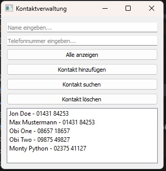

# GUI-Phonebook

A very simple phonebook application built with **Python** and **PyQt5** as a learning project.

## Features

- Add and delete contacts
- Search for contacts by name
- Display all contacts

## Screenshot



## Run

Install PyQt5:

```bash
python -m pip install PyQt5
```

Start the application:

```bash
python main.py
```

**Note:** Contacts are stored in memory and reset when the application restarts. Persistent storage was intentionally excluded from the scope of this MVP.
